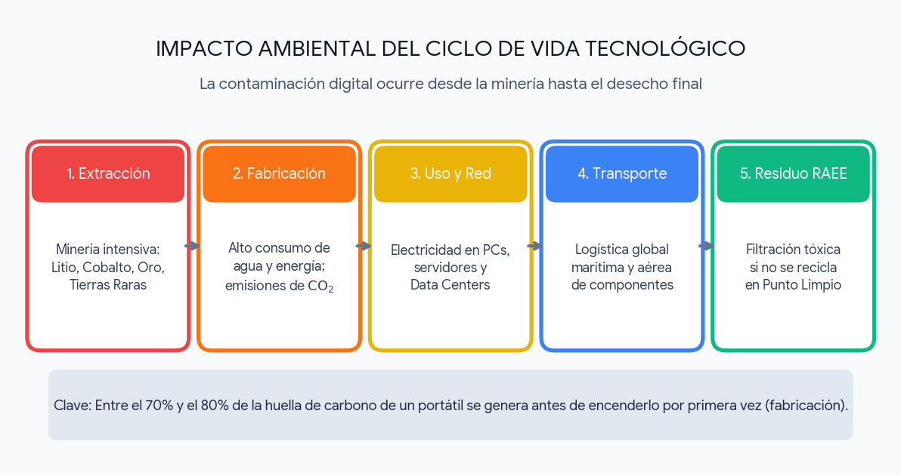
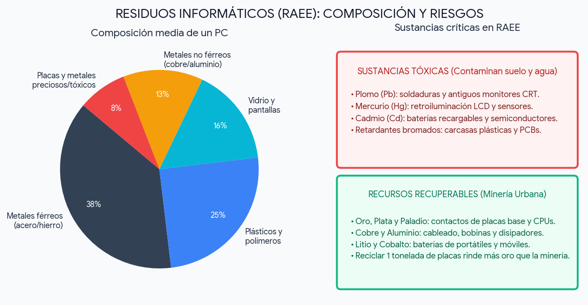
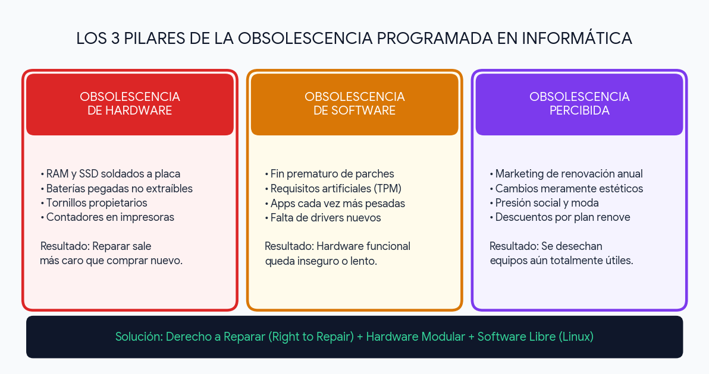
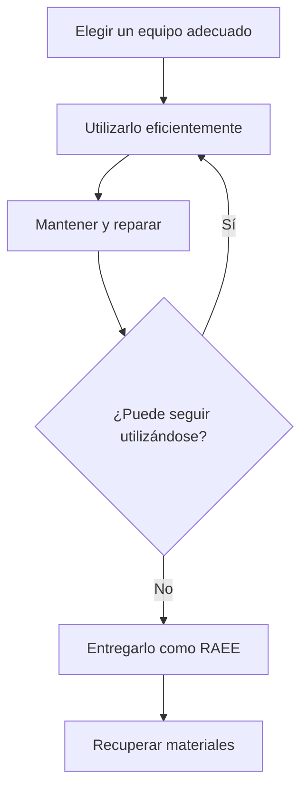
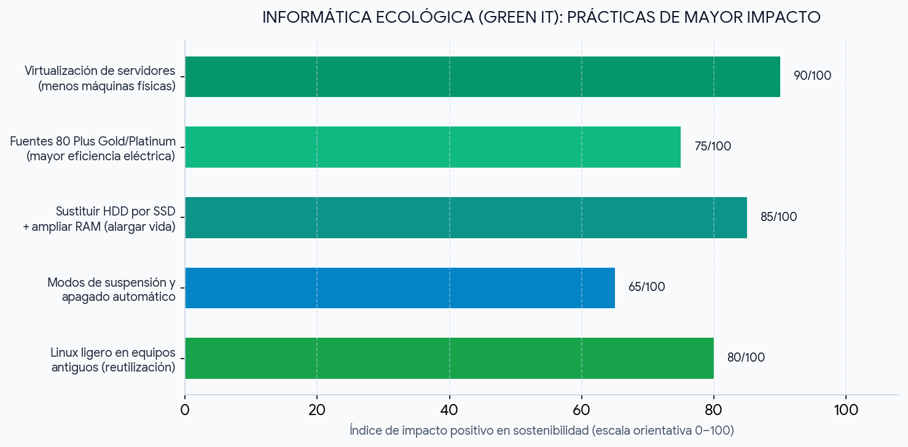

# 🌱 Informática ambiental y sostenibilidad tecnológica

> Proyecto sobre el impacto ambiental de la informática y las medidas que permiten utilizar la tecnología de forma más responsable.

## Índice

1. [Contaminación ambiental](#1-contaminación-ambiental)
2. [Residuos informáticos (RAEE)](#2-residuos-informáticos-raee)
3. [Obsolescencia programada](#3-obsolescencia-programada)
4. [Informática ecológica (Green IT)](#4-informática-ecológica-green-it)
5. [Buenas prácticas](#5-buenas-prácticas)
6. [Conclusión](#6-conclusión)
7. [Referencias](#7-referencias)
8. [Autores](#8-autores)

---

## 1. Contaminación ambiental

La **contaminación ambiental** es la alteración del entorno natural por la presencia de sustancias, residuos o formas de energía que pueden perjudicar a los ecosistemas y a la salud de las personas. Puede afectar al aire, al agua y al suelo.

La informática también tiene impacto ambiental, aunque muchos de sus servicios parezcan digitales. Para fabricar y utilizar dispositivos se necesitan materias primas, energía, agua y transporte.

- **Extracción de materias primas:** la fabricación de ordenadores y móviles requiere materiales como cobre, aluminio, litio y otros minerales. Su extracción puede modificar el paisaje y consumir recursos.
- **Fabricación:** producir placas, pantallas, baterías y otros componentes requiere energía y genera emisiones y residuos industriales.
- **Uso:** los ordenadores, redes y centros de datos consumen electricidad. El impacto depende, entre otros factores, de la eficiencia de los equipos y del origen de la energía.
- **Fin de vida:** abandonar aparatos electrónicos o desmontarlos sin control puede liberar sustancias perjudiciales y desperdiciar materiales recuperables.

Por tanto, el impacto no se limita a la electricidad que consume un ordenador mientras está encendido: también cuenta cómo se fabrica, cuánto tiempo se utiliza y qué ocurre cuando deja de servir.

## 2. Residuos informáticos (RAEE)

Los **Residuos de Aparatos Eléctricos y Electrónicos (RAEE)** son los aparatos eléctricos o electrónicos que se desechan al final de su vida útil. En informática encontramos, por ejemplo, ordenadores, portátiles, monitores, discos duros, placas base, teclados, ratones, impresoras, routers y baterías.

### ¿Por qué hay que gestionarlos correctamente?

Los equipos electrónicos contienen materiales que pueden recuperarse, pero también componentes o sustancias que requieren una gestión controlada. Si se abandonan, se queman o se desmontan de forma inadecuada, pueden contaminar el suelo, el agua y el aire.

| Tipo de material | Ejemplos | Qué hacer |
|---|---|---|
| Materiales recuperables | Cobre, aluminio, hierro y algunos metales presentes en circuitos | Entregarlos a gestores autorizados para su recuperación |
| Componentes que requieren gestión específica | Baterías, pantallas y determinados componentes electrónicos | No desmontarlos ni mezclarlos con la basura doméstica |
| Aparatos reutilizables | Ordenadores, monitores o periféricos que todavía funcionan | Valorar su reparación, donación o reutilización segura |

> [!IMPORTANT]
> **En España:** no tires los aparatos electrónicos ni sus baterías al contenedor convencional. Llévalos a un punto limpio o utiliza los sistemas de recogida habilitados por distribuidores y gestores autorizados. Consulta las condiciones de recogida de tu municipio o establecimiento.

### Ejemplo práctico

Un ordenador que ya no utilizamos puede tener una segunda vida si se comprueba su estado, se borran correctamente los datos personales y se repara o se entrega para su reutilización. Si no puede aprovecharse, debe llevarse a un punto de recogida de RAEE.

## 3. Obsolescencia programada

La **obsolescencia programada** es la práctica de diseñar o comercializar productos para que su vida útil sea limitada o para que el consumidor tenga motivos para sustituirlos antes de lo necesario. No toda avería ni toda incompatibilidad significa que exista obsolescencia programada: hay que valorar cada caso.

En informática se puede relacionar con varias situaciones:

1. **Limitaciones de hardware:** componentes difíciles de sustituir, baterías no reemplazables o memoria soldada que impide ampliar el equipo.
2. **Fin del soporte de software:** un dispositivo puede seguir funcionando, pero dejar de recibir actualizaciones de seguridad o compatibilidad.
3. **Obsolescencia percibida:** la publicidad o las nuevas versiones pueden hacer que un dispositivo parezca anticuado aunque todavía cubra las necesidades de su usuario.

### ¿Cómo reducirla?

- Reparar los componentes averiados cuando sea viable.
- Ampliar la memoria RAM o sustituir un disco duro por un SSD si el equipo lo permite.
- Comprobar los requisitos y el soporte de seguridad antes de instalar un sistema operativo.
- Elegir, cuando sea posible, equipos con repuestos disponibles y diseño reparable.
- Comprar un dispositivo nuevo solo cuando el actual ya no cubra las necesidades o no pueda mantenerse de forma segura.

## 4. Informática ecológica (Green IT)

La **informática ecológica**, también llamada *Green IT*, reúne prácticas para reducir el impacto ambiental de los equipos y servicios informáticos durante su fabricación, uso y retirada.

### Medidas que se pueden aplicar

- **Ahorrar energía:** configurar la suspensión automática, ajustar el brillo y apagar los equipos que no se utilicen.
- **Alargar la vida útil:** mantener los equipos limpios, actualizar el software y reparar antes de sustituir.
- **Elegir equipos eficientes:** comparar el consumo energético y las características de eficiencia antes de comprar.
- **Optimizar servidores:** consolidar servicios o utilizar virtualización cuando el análisis de carga y consumo demuestre que supone un ahorro real.
- **Gestionar los residuos:** separar los aparatos y entregarlos a sistemas autorizados.
- **Reducir impresiones:** utilizar documentos digitales cuando sea adecuado y configurar la impresión a doble cara.

### Ciclo de uso responsable

## 5. Buenas prácticas

Lista de acciones que se pueden aplicar en casa, en clase o en el trabajo:

- [ ] Activar la suspensión automática y los modos de ahorro energético.
- [ ] Apagar los equipos cuando no se vayan a utilizar durante un periodo prolongado.
- [ ] Reparar o ampliar el ordenador antes de comprar otro, siempre que sea viable y seguro.
- [ ] Llevar baterías y aparatos averiados a un punto de recogida autorizado.
- [ ] Evitar impresiones innecesarias.
- [ ] Borrar los datos personales de forma segura antes de entregar un equipo para reutilización.

## 6. Conclusión

La tecnología facilita muchas actividades, pero también necesita recursos y genera residuos. La mejor forma de reducir su impacto es tener en cuenta todo su ciclo de vida: comprar con criterio, consumir menos energía, mantener y reparar los dispositivos y gestionar correctamente los RAEE. Pequeñas decisiones de usuarios, empresas y centros educativos pueden contribuir a una informática más sostenible.

## 7. Referencias

- **Ministerio para la Transición Ecológica y el Reto Demográfico (MITECO):** [Residuos de aparatos eléctricos y electrónicos (RAEE)](https://www.miteco.gob.es/).
- **Unión Europea:** [Directiva 2012/19/UE sobre residuos de aparatos eléctricos y electrónicos](https://eur-lex.europa.eu/eli/dir/2012/19/oj).
- **Boletín Oficial del Estado:** [Real Decreto 110/2015, sobre residuos de aparatos eléctricos y electrónicos](https://www.boe.es/eli/es/rd/2015/02/20/110).
- **UNITAR / ITU:** [The Global E-waste Monitor](https://ewastemonitor.info/).
- **ENERGY STAR:** [Productos y eficiencia energética](https://www.energystar.gov/).

## 8. Autores

| Autor | Usuario de GitHub | Trabajo realizado |
|---|---|---|
| José Guerrero Marín | [@JGuerrero-11](https://github.com/JGuerrero-11) | Contaminación ambiental, RAEE, maquetación e imágenes |
| Arturo | [@Arturo885](https://github.com/Arturo885) | Obsolescencia programada, Green IT, revisión y referencias |

---

**Característica Markdown adicional:** este proyecto incorpora tablas, listas de tareas, notas desplegables, avisos, enlaces, imágenes, y un diagrama Mermaid.
